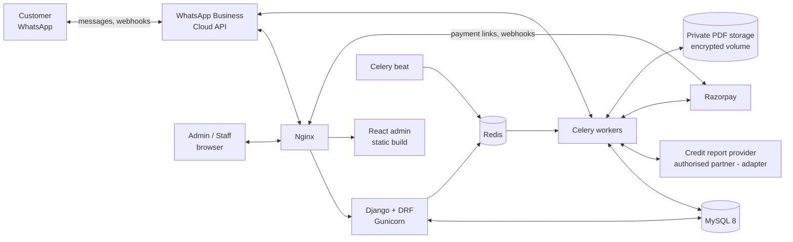
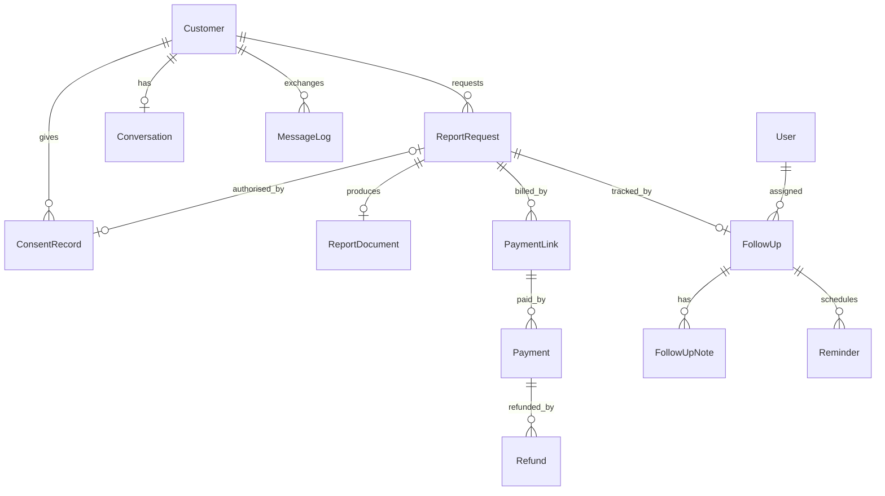
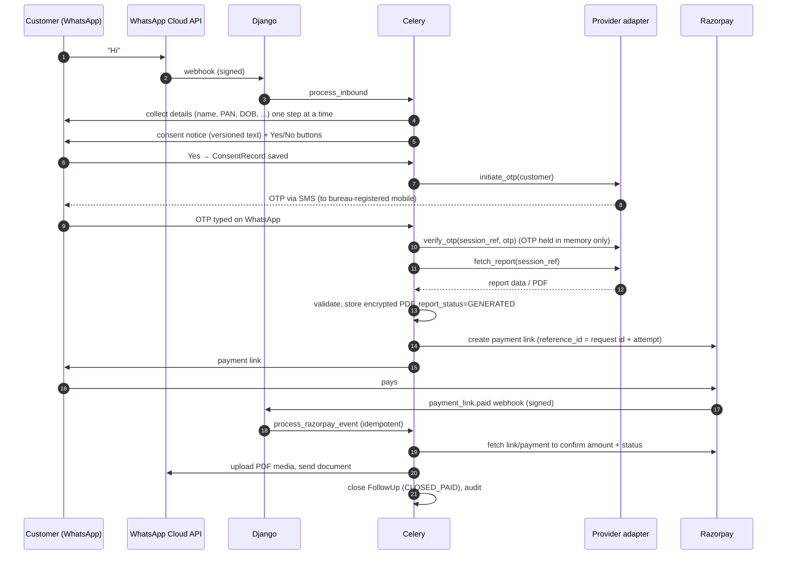

# WhatsApp CIBIL Report Platform — Architecture

Status: **Draft v0.1** (2026-11-21) · Owner: AV Management · Phase 0 deliverable

This document describes the target architecture. Anything marked **[OPEN]** needs a decision or
external documentation before it can be built. No credit-bureau or provider endpoint is assumed:
every external system sits behind a service adapter with a mock implementation until real
documentation and credentials exist.

---

## 1. Context



Principles

1. **Webhooks are acknowledged fast, processed asynchronously.** Webhook views verify the signature,
   persist the event, enqueue a task and return 200. All real work happens in Celery.
2. **Every external call goes through an adapter** (`CreditReportProvider`, `WhatsAppGateway`,
   `PaymentGateway`). Each has a `Mock*` implementation used in dev and tests.
3. **Three independent status fields** — report, payment, follow-up — never one combined status.
4. **Idempotency everywhere**: unique external IDs, DB constraints, and `select_for_update` locks,
   not "check then insert" in application code alone.
5. **PII is encrypted at field level** and never written to logs, webhook archives or message logs
   in clear text. OTPs are never persisted at all.

---

## 2. Repository layout

The current folder contains empty `backend/`, `frontend/`, `infrastructure/`, `docs/`, `tests/`
directories, an empty `README.md.txt`, and `.env.example` **as a directory** (should be a file).
Phase 1 will fix the last two after confirmation. Proposed layout:

```
cibil-whatsapp-platform/
├── backend/
│   ├── manage.py
│   ├── pyproject.toml / requirements/{base,dev,prod}.txt
│   ├── config/                 # settings (base/dev/test/prod), urls, celery.py, wsgi
│   └── apps/
│       ├── core/               # encryption fields, blind index, base models, idempotency, utils
│       ├── accounts/           # User, roles, permissions, 2FA
│       ├── customers/          # Customer, ConsentRecord
│       ├── conversations/      # WhatsApp bot state machine
│       ├── reports/            # ReportRequest, ReportDocument, provider adapters
│       ├── payments/           # PaymentLink, Payment, Refund, Razorpay adapter + webhooks
│       ├── messaging/          # WhatsApp adapter, MessageLog, templates, webhooks
│       ├── followups/          # FollowUp, FollowUpNote, Reminder, escalation
│       ├── audit/              # AuditLog (append-only)
│       └── analytics/          # dashboard + revenue queries, daily aggregates
├── frontend/                   # Vite + React + Tailwind admin SPA
├── infrastructure/
│   ├── docker/                 # Dockerfiles
│   ├── nginx/                  # nginx.conf, TLS
│   └── compose/                # docker-compose.{dev,prod}.yml
├── tests/                      # cross-cutting e2e / contract tests (unit tests live per app)
├── docs/
└── .env.example                # file, no real secrets
```

---

## 3. Domain model

### 3.1 Status separation

| Entity | Field | Values |
|---|---|---|
| `Conversation` | `state` | see §5 (bot flow position) |
| `ReportRequest` | `report_status` | `DRAFT → CONSENTED → OTP_SENT → OTP_VERIFIED → FETCHING → GENERATED → (FAILED \| NO_HIT \| EXPIRED \| CANCELLED)` |
| `ReportRequest` | `delivery_status` | `NOT_DELIVERED → QUEUED → SENT → DELIVERED → READ \| FAILED` |
| `PaymentLink` | `status` | `PENDING → ACTIVE → PAID \| EXPIRED \| CANCELLED`, or `PENDING → FAILED` (sending is tracked by `sent_count`, not a status) |
| `Payment` | `status` | `AUTHORIZED → CAPTURED \| FAILED`; `CAPTURED → PARTIALLY_REFUNDED → REFUNDED` |
| `Refund` | `status` | `REQUESTED → APPROVED \| REJECTED`; `APPROVED → PROCESSING → PROCESSED \| FAILED` |
| `FollowUp` | `status` | `OPEN → IN_PROGRESS → ESCALATED → CLOSED_PAID \| CLOSED_LOST \| CLOSED_MANUAL` |

Derived "overall" views (e.g. "generated but unpaid") are **queries**, not stored fields.

### 3.2 Entities (key fields only)



> **Phase 3 notes (as built):** encrypted fields are named plainly (`wa_id`, `full_name`, `pan`, `dob`,
> `email`, `pincode`) and typed `EncryptedTextField`; blind indexes are `wa_id_hash` / `pan_hash`.
> `ReportRequest.consent` points at the `ConsentRecord` (not the other way round) so `customers` does not
> depend on `reports`. One `Conversation` per customer (its state resets per request; history is in
> `MessageLog`). `PaymentLink.open_lock` enforces one open link per request, the same way `active_lock`
> enforces one open request per customer. A request stays open while `GENERATED` until delivered.
> Refunds enforce a four-eyes rule in the database (approver ≠ requester). Django admin is read-only
> and requires a 2FA-verified session (`OTPAdminSite`).

**Customer**
- `id` (UUID), `wa_id_hash` (HMAC blind index, unique), `wa_id_enc`
- `full_name_enc`, `pan_enc`, `pan_hash` (blind index), `dob_enc`, `email_enc`, `pincode_enc`, `gender`
- Provider-required fields are configurable per adapter (`provider.required_fields()`) **[OPEN]**
- `opted_out_at`, `created_at`, `updated_at`, soft-delete / anonymised flags for DPDP erasure

**ConsentRecord** — immutable
- `customer`, `report_request`, `consent_text_version`, `consent_text_sha256`,
  `wa_message_id` (the inbound "YES"), `given_at`, `purpose`, `withdrawn_at`

**ReportRequest**
- `id`, `public_ref` (short human ref, e.g. `CR-7KQ2M9`), `customer`
- `report_status`, `delivery_status`, `failure_code`, `failure_detail`
- `provider_name`, `provider_session_ref` (OTP/transaction ref from provider), `provider_report_ref`
- `otp_attempts`, `otp_sent_at`, `otp_expires_at` — **never the OTP itself**
- `price_paise` (snapshot at creation), `currency`
- `active_lock` — nullable, see §6.2
- `generated_at`, `expires_at` (report validity for sale), `delivered_at`

**ReportDocument**
- `report_request` (1:1), `storage_key` (opaque path in private volume), `sha256`,
  `size_bytes`, `encryption_key_id`, `score` (optional, encrypted), `wa_media_id`, `wa_media_expires_at`,
  `purge_after`

**PaymentLink**
- `report_request`, `razorpay_link_id` (unique), `reference_id` (unique, our idempotency key),
  `short_url`, `amount_paise`, `status`, `expires_at`, `sent_count`, `last_sent_at`, `created_by` (null = system)

**Payment**
- `payment_link`, `razorpay_payment_id` (unique), `razorpay_order_id`, `amount_paise`, `method`,
  `status`, `captured_at`, `raw` (sanitised JSON)

**Refund**
- `payment`, `razorpay_refund_id` (unique), `amount_paise`, `reason`, `status`, `requested_by`, `approved_by`

**WebhookEvent** (one table, `source` = razorpay | whatsapp)
- `source`, `event_id` (unique with source), `event_type`, `signature_valid`, `payload` (sanitised),
  `received_at`, `processed_at`, `processing_status`, `attempts`, `last_error`

**Conversation**
- `customer`, `state`, `context` (JSON, PII-free: refs only), `last_inbound_at` (drives 24-h window),
  `state_entered_at`, `active_report_request`

**MessageLog**
- `customer`, `direction`, `wa_message_id` (unique), `type` (text/template/document/interactive),
  `template_name`, `body_redacted`, `status` (`queued/sent/delivered/read/failed`), `error_code`,
  `sent_by` (user or system), `related_report_request`, timestamps per status

**FollowUp**
- `report_request` (1:1), `status`, `assigned_to`, `priority`, `next_reminder_at`, `escalation_level`,
  `escalated_at`, `closed_at`, `close_reason`

**FollowUpNote** — `follow_up`, `author`, `body`, `channel` (call/whatsapp/other), `outcome`, `created_at` (immutable)

**Reminder** — `follow_up`, `scheduled_for`, `kind` (auto/manual), `template_name`, `status`
(`scheduled/sent/skipped/failed/cancelled`), `sent_message`, `celery_task_id`

**AuditLog** — append-only: `actor` (user / system / webhook), `action`, `object_type`, `object_id`,
`changes` (redacted diff), `ip`, `user_agent`, `request_id`, `created_at`, `prev_hash`, `hash`
(hash chain makes tampering detectable).

**User** (custom, from day one) — email login, `role`, `is_active`, TOTP device, `last_login_ip`.

---

## 4. Customer workflow (sequence)



Notes
- The provider decides where the OTP is sent (normally the mobile registered with the bureau,
  which may differ from the WhatsApp number). Copy must say so. **[OPEN]**
- `NO_HIT` (no credit history) and provider failures never create a payment link.
- **Business risk:** the report is pulled (and the provider likely bills us) *before* the customer
  pays. Mitigations built in: one active request per customer (§6.2), configurable cooldown,
  per-number daily caps, reuse of a still-valid generated report instead of re-pulling, and a
  feature flag to switch to *pay-first* later without schema changes.

---

## 5. WhatsApp conversation state machine

```
NEW → ASK_NAME → ASK_PAN → ASK_DOB → [ASK_EXTRA_FIELDS...] → CONFIRM_DETAILS
    → AWAITING_CONSENT ─(No)→ ENDED
          │(Yes)
          ▼
    OTP_REQUESTING → AWAITING_OTP ⇄ (wrong OTP, attempts < max) 
          │ (verified)              └─(attempts exhausted / expired)→ OTP_FAILED → offer RESEND
          ▼
    FETCHING_REPORT → AWAITING_PAYMENT → DELIVERED
          └→ REPORT_FAILED / NO_HIT
```

- Implemented as an explicit transition table (`conversations/state_machine.py`), each handler a pure
  function `(conversation, inbound_message) -> (new_state, outbound_messages, side_effect_tasks)`, which
  makes it unit-testable without WhatsApp.
- Global commands at any state: `HELP`, `CANCEL`/`RESTART`, `STOP` (opt-out → no further marketing/reminders).
- Input validation: PAN regex `[A-Z]{5}[0-9]{4}[A-Z]`, DOB parsing + age ≥ 18, name length, etc.
- Idle timeout (e.g. 30 min) resets to a resumable state; OTP expiry follows provider TTL.
- Inbound messages are de-duplicated by `wa_message_id` (WhatsApp retries webhooks).
- Per-customer serialisation: inbound processing takes a Redis lock keyed by `wa_id_hash` so two
  messages from one user are never processed concurrently.

**24-hour customer-service window.** Free-form messages are only allowed within 24 h of the
customer's last inbound message. Payment reminders, follow-ups and late PDF deliveries outside the
window **must use pre-approved WhatsApp templates** (utility category). `MessagingService` checks
`last_inbound_at` and selects free-form vs template automatically; staff UI shows the window state.

---

**Phase 7 notes (as built):**
- Inbound path: the webhook stores one `WebhookEvent` per message (sender encrypted, no text), parks the text
  in Redis for `WHATSAPP_INBOUND_BODY_TTL` seconds and queues the event id. The worker reads the text once
  (deleting it), takes a per-customer lock, logs the message with a placeholder for personal answers
  (`[name]`, `[PAN]`, `[date of birth]`, `[OTP REDACTED]`), runs the state handler, saves, sends replies
  (idempotent per message), then runs queued effects such as starting the fetch.
- OTP verification runs inside that worker step, so the OTP never reaches the database, broker or logs.
- Returning customers reuse their saved (encrypted) details after confirming them.
- A report counts as finished once the PDF is handed to WhatsApp (`delivery_status = SENT`); delivery
  receipts upgrade it to DELIVERED/READ but are not required to release the customer's request lock.
- Background outcomes (no credit history, failure, delivered) are pushed to the customer by
  `apps/conversations/notify.py` with conditional state updates.

## 6. Cross-cutting requirements

### 6.1 Idempotent Razorpay webhook processing
1. View reads the **raw body**, verifies `X-Razorpay-Signature` (HMAC-SHA256 with the webhook secret,
   constant-time compare). Invalid → 400, logged, not processed.
2. `WebhookEvent` insert keyed by (`razorpay`, `X-Razorpay-Event-Id`). `IntegrityError` → already seen → 200.
3. Enqueue `process_razorpay_event(event_pk)`; return 200.
4. Task: `select_for_update` on the `PaymentLink`; if already `PAID`, no-op. Otherwise **re-fetch the
   payment link/payment from Razorpay API** and check `amount == price_paise`, `currency == INR`,
   `status == paid/captured`, and `reference_id` matches. Only then transition and enqueue delivery.
5. A beat job (`reconcile_pending_payment_links`, every 10 min) fetches open links so a missed webhook
   can't leave a paid customer undelivered.
Events handled: `payment_link.paid`, `payment_link.expired`, `payment_link.cancelled`,
`payment.captured`, `payment.failed`, `refund.created`, `refund.processed`, `refund.failed`.
(Event names to be re-checked against current Razorpay docs during Phase 6.)

**Phase 6 notes (as built):** endpoint `POST /webhooks/razorpay` (`apps/payments/webhooks.py`). The stored
payload is an allowlist of ids/amounts/statuses (no contact, e-mail, VPA, card or notes). Webhook bodies are
treated as hints: processing always re-fetches the link from Razorpay (`PaymentService.sync_link`).
Amount mismatches leave the event `FAILED` with `payment_mismatch` for staff review instead of retrying.
Refunds are retry-safe: before creating a refund after an ambiguous failure, the gateway is searched for an
existing refund carrying our reference (`notes.refund_ref`), so a timeout can never cause a double refund.
`refund.processed` / `refund.failed` webhooks finish refunds that Razorpay reports as `pending`.

### 6.2 Duplicate report prevention
- `ReportRequest.active_lock` is set to the customer id while the request is in a non-terminal state
  and to `NULL` when terminal; a **unique index on `active_lock`** gives "one active request per customer"
  at the DB level (MySQL has no partial unique indexes; NULLs don't collide).
- `fetch_report` task: `select_for_update` on the request, proceeds only from `OTP_VERIFIED`, moves to
  `FETCHING` in the same transaction. Retries after a crash check provider status by
  `provider_session_ref` before re-requesting.
- A still-valid `GENERATED` unpaid report for the same customer + PAN is reused (resend payment link)
  instead of pulling again.

### 6.3 Secure private PDF storage
- PDFs live in a Docker volume **outside** any Nginx-served path (`/data/private/reports/`), file name
  = random UUID, content encrypted with AES-GCM (key from env / KMS, `encryption_key_id` stored for rotation).
- Storage behind a `ReportStorage` interface (local now; S3-compatible with SSE later).
- Delivery to WhatsApp: decrypt in memory → upload via Cloud API media endpoint → send document by
  `media_id`. **No public URL is ever created.**
- Admin download: authenticated streaming endpoint, permission-checked, audit-logged, `Content-Disposition: attachment`, `Cache-Control: no-store`.
- Retention: `purge_after` (configurable, e.g. 30 days after delivery); beat job deletes file, keeps metadata.

### 6.4 Encryption of sensitive data
- Custom `EncryptedTextField` using `cryptography` **MultiFernet** (key rotation: new key first, old keys
  still decrypt; management command re-encrypts).
- Searchable fields (WhatsApp number, PAN) also get an HMAC-SHA256 **blind index** with a separate key,
  so lookups don't need decryption.
- Keys come from environment / secret files, never from the DB or repo. Separate keys for: field
  encryption, blind index, PDF encryption, Django `SECRET_KEY`.
- UI shows masked values (`ABCDE****F`, `+91 98xxxxxx12`); "reveal" requires permission and is audit-logged.
- MySQL: TLS in transit if not on the same host; encrypted backups.

### 6.5 OTP handling
- The OTP is never stored: not in DB, not in `MessageLog` (body saved as `[OTP REDACTED]`), not in
  `WebhookEvent.payload` (sanitiser strips text bodies while the conversation is in `AWAITING_OTP`),
  not in Celery arguments (task receives the `wa_message_id`; the OTP is extracted from the
  in-flight webhook payload held in Redis with a ≤ 5-minute TTL and deleted after use) and not in logs
  (logging filter). **[Decision]** Alternative: verify synchronously inside the webhook request — rejected
  because provider latency would delay the webhook ACK.
- Verification is done **only by the provider** (`provider.verify_otp`); we never generate or compare OTPs.
- Attempt limit (default 3) and resend limit (default 2) per request, plus per-number rate limits.

### 6.6 Authentication & roles
- Django session auth + CSRF for the SPA (same origin behind Nginx), secure/HttpOnly/SameSite=Lax cookies.
  Rationale: avoids storing tokens in the browser.
- TOTP 2FA (`django-otp`) mandatory for Super Admin, Admin and Finance (refund approval), optional for
  others — but once a user enrols, every login must pass it.
- Login rate limiting, lockout, password validators, session timeout.

| Permission | Super Admin | Admin | Follow-up Agent | Finance | Auditor (read-only) |
|---|---|---|---|---|---|
| Dashboard | ✓ | ✓ | own queue | ✓ | ✓ |
| View customers (masked) | ✓ | ✓ | assigned only | ✓ | ✓ |
| Reveal PII | ✓ | ✓ | – | – | – |
| Report requests: view / retry / cancel | ✓ | ✓ | view | view | view |
| Download report PDF | ✓ | ✓ | – | – | – |
| Resend payment link / manual WhatsApp | ✓ | ✓ | ✓ (assigned) | – | – |
| Follow-up notes / reminders | ✓ | ✓ | ✓ (assigned) | – | view |
| Assign follow-ups | ✓ | ✓ | – | – | – |
| Refund request | ✓ | ✓ | – | ✓ | – |
| Refund approve | ✓ | – | – | ✓ | – |
| Revenue analytics | ✓ | ✓ | – | ✓ | ✓ |
| Staff management | ✓ | – | – | – | – |
| Audit logs | ✓ | – | – | – | ✓ |
| Settings (price, templates, flags) | ✓ | – | – | – | – |

Implemented as a `role` field on `User` and a role → capability matrix in code
(`apps/accounts/capabilities.py`), enforced by DRF permission classes (`require("refund.approve")`) plus
object-level checks. **[Decision, Phase 2]** A code matrix instead of editable Django groups: permission
changes go through code review and the audit trail, and tests pin the rules (e.g. auditors are read-only,
admins cannot approve refunds).

### 6.7 Retry & failure handling
- Adapters raise typed errors: `TransientError` (timeouts, 5xx, 429) vs `PermanentError` (4xx validation,
  invalid OTP, no-hit).
- Celery tasks: `autoretry_for=(TransientError,)`, exponential backoff with jitter, `max_retries` per
  task type, `acks_late=True`, `reject_on_worker_lost=True`. After the last retry the domain object
  moves to a `FAILED` state with `failure_code`, a staff alert is created, and the customer gets a
  "we'll get back to you" message.
- Outbound HTTP: timeouts on every call (connect 5s / read 30s), circuit breaker per provider (Redis counter).
- Separate queues: `webhooks`, `provider`, `messaging`, `payments`, `reminders`, `default` so a slow
  provider can't block payment processing.

### 6.8 Audit logging
- `audit.log(actor, action, obj, changes)` service called explicitly from services (not signals only,
  so intent is recorded), plus middleware that attaches `request_id`, IP, UA.
- Logged: logins/failures, PII reveal, PDF download, payment link create/resend, refunds, manual
  messages, assignment changes, status overrides, settings and staff changes, webhook signature failures.
- Append-only: no update/delete in the ORM manager, no admin delete; hash chain for tamper evidence.

### 6.9 Observability
- Structured JSON logs with `request_id`/`task_id`, PII-scrubbing filter.
- Sentry (optional) for errors; `/healthz` (liveness) and `/readyz` (DB + Redis) endpoints;
  Flower restricted to admins/VPN.

---

## 7. Follow-up management

- A `FollowUp` is created automatically when a report reaches `GENERATED` and a payment link is sent.
- Auto reminder cadence (configurable): +1 h (free-form if inside window), +24 h, +72 h (templates).
  Reminders stop when: paid, customer opted out, report expired, or follow-up closed.
- `dispatch_due_reminders` beat task every minute: selects due `Reminder`s with `select_for_update(skip_locked=True)`
  so multiple workers never double-send.
- Escalation sweep (hourly): unpaid > N hours and no note in M hours → `ESCALATED`, `escalation_level += 1`,
  notify assignee/admin (in-app notification; email optional).
- Resend payment link: reuse the existing link if not expired, else create a new one (new `reference_id`),
  expire the old one.
- On verified payment: `FollowUp → CLOSED_PAID`, pending reminders cancelled, audit entry.
- Assignment: manual, or round-robin among active agents (setting).

---

## 8. Backend API (DRF) — outline

All under `/api/v1/`, JSON, paginated, filterable (`django-filter`), OpenAPI via `drf-spectacular`.

| Area | Endpoints |
|---|---|
| Auth | `POST auth/login`, `POST auth/logout`, `POST auth/2fa/verify`, `GET auth/me`, `GET auth/csrf` |
| Dashboard | `GET dashboard/summary`, `GET analytics/funnel`, `GET analytics/revenue?from&to&granularity` |
| Customers | `GET customers`, `GET customers/{id}`, `POST customers/{id}/reveal`, `GET customers/{id}/timeline` |
| Report requests | `GET report-requests`, `GET .../{id}`, `POST .../{id}/retry`, `POST .../{id}/cancel`, `GET .../{id}/document` (download) |
| Payments | `GET payment-links`, `POST report-requests/{id}/payment-links/resend`, `GET payments`, `POST payments/{id}/refunds`, `POST refunds/{id}/approve` |
| Follow-ups | `GET follow-ups?status&assigned_to&overdue`, `PATCH follow-ups/{id}` (assign/status), `POST follow-ups/{id}/notes`, `POST follow-ups/{id}/reminders`, `DELETE reminders/{id}` |
| Messaging | `GET messages`, `POST customers/{id}/messages` (manual; template enforced outside window), `GET whatsapp/templates` |
| Staff | `GET/POST users`, `PATCH users/{id}`, `POST users/{id}/reset-2fa` |
| Audit | `GET audit-logs` |
| Settings | `GET/PATCH settings` (price, reminder cadence, feature flags) |
| Webhooks (no auth, signature-verified, CSRF-exempt) | `GET/POST webhooks/whatsapp`, `POST webhooks/razorpay` |

---

**Phase 5 notes (as built):** the full contract is `docs/openapi.yaml` (regenerate with
`manage.py spectacular --file ../docs/openapi.yaml`). Differences from the outline above:
- Refunds: `POST payments/{id}/refunds` → `POST refunds/{id}/approve|reject`; approval queues
  `payments.process_refund`. A request cannot exceed the refundable amount minus refunds already in flight.
- Follow-ups: `GET/POST follow-ups/{id}/notes`, `GET/POST follow-ups/{id}/reminders`, `DELETE reminders/{id}`
  (cancels, never deletes). Filters: `status`, `open`, `assignee=me|unassigned|<id>`, `overdue`, `priority`.
- Report requests: `?unpaid=true` lists generated-but-unpaid; `payment_status` is derived, not stored.
- Agents are scoped to records whose follow-up is assigned to them (other records return 404).
- `GET audit-logs/verify` checks the hash chain; `GET analytics/revenue?export=csv` downloads CSV.
- `GET settings` is read-only (PATCH needs a DB-backed settings model — deferred).
- Domain errors map to HTTP: invalid state → 409, external/business rule failure → 422 with a `code`.

## 9. Integration adapters

```python
class CreditReportProvider(ABC):
    name: str
    def required_fields(self) -> list[FieldSpec]: ...
    def initiate_otp(self, applicant: Applicant, consent: ConsentRef) -> OtpSession: ...   # provider_ref, expires_at, masked_destination
    def resend_otp(self, session_ref: str) -> OtpSession: ...
    def verify_otp(self, session_ref: str, otp: str) -> VerifyResult: ...                    # VERIFIED / INVALID / EXPIRED / LOCKED
    def fetch_report(self, session_ref: str) -> ReportResult: ...                            # status, report_ref, pdf_bytes | structured data, score
    def get_status(self, session_ref: str) -> ProviderStatus: ...
```

- Implementations: `MockCreditReportProvider` (deterministic scenarios driven by test PAN values:
  success, no-hit, invalid OTP, timeout), `UnconfiguredProvider` (raises a clear error in prod if not set).
  The real adapter is written only once the authorised partner's documentation is available.
- If the provider returns structured data but no PDF, a `ReportRenderer` (WeasyPrint/HTML template)
  builds the PDF — layout and branding rules depend on the provider agreement. **[OPEN]**
- `WhatsAppGateway`: `send_text`, `send_interactive`, `send_template`, `upload_media`, `send_document`,
  webhook signature verification (`X-Hub-Signature-256`, app secret) and verify-token handshake.
  `MockWhatsAppGateway` records sent messages for tests.
- `PaymentGateway` (Razorpay): `create_payment_link`, `fetch_payment_link`, `cancel_payment_link`,
  `fetch_payment`, `create_refund`, `verify_webhook_signature`. Uses the official `razorpay` Python SDK.

---

**Phase 4 notes (as built):**
- Adapters are chosen by settings (`CREDIT_PROVIDER`, `PAYMENT_GATEWAY`, `WHATSAPP_GATEWAY`); dev and tests
  use `mock`. A startup check refuses mock adapters when `DEBUG` is off unless `ALLOW_MOCK_ADAPTERS` is set.
- OTP verification is a service call, not a Celery task, so the OTP never enters the broker. Phase 7 calls
  it from the inbound-message path. Every attempt is counted before the provider call.
- `fetch_report` claims the request (`OTP_VERIFIED → FETCHING`) in a DB transaction before calling the
  provider, so a report is pulled at most once; a retry after a crash resumes from `FETCHING`.
- External calls never run under a DB row lock; a short Redis lock (`distributed_lock`) serialises them per
  request instead.
- Transient adapter errors retry with jittered exponential backoff; when retries run out the request is
  marked `FAILED` with `provider_unavailable` (no task is left silently dead).
- Report PDFs: AES-256-GCM with the storage key as associated data (swapped files are detected); key id is
  stored with each file so `REPORT_FILE_ENCRYPTION_KEYS` can rotate.
- Duplicate payments (customer pays an old and a new link) are recorded and audited as `payment.duplicate`
  for refund, never silently dropped.

**Phase 10 notes (as built, Surepass):** `CreditReportProvider.requires_otp = False` providers go
CONSENTED → FETCHING directly (`fetch_report_without_otp`). Because the bureau then does not verify that
the requester owns the PAN, `ReportService._pan_guard` refuses a PAN already reported for another WhatsApp
number, or a second PAN for the same number, within `PAN_GUARD_DAYS` (default 30). The `mobile` sent to the
provider is always the customer's own WhatsApp number, never a typed number. Consent text line 2 and the
consent version (`…-direct`) reflect the no-OTP flow.

## 10. Admin dashboard (React)

Stack: Vite, React 18, React Router, TanStack Query, Tailwind, React Hook Form + Zod, Recharts.

Pages: Login/2FA · Dashboard (KPIs: requests today, generated, paid, conversion, revenue, unpaid
value, failure rate; funnel; trend) · Customers (list/detail/timeline) · Report requests · Payments &
links · Refunds · Follow-ups (queue with filters: unassigned/mine/overdue/escalated; detail with notes,
reminders, resend link, send WhatsApp) · Message logs · Revenue reports (date range, CSV export) ·
Staff · Audit log · Settings.

The UI hides actions the role can't perform, but **the API is the enforcement point**.

---

## 11. Background jobs (Celery beat)

| Task | Schedule | Purpose |
|---|---|---|
| `dispatch_due_reminders` | 1 min | send scheduled reminders |
| `escalate_overdue_followups` | 1 h | escalation sweep |
| `reconcile_pending_payment_links` | 10 min | catch missed Razorpay webhooks |
| `expire_stale_requests` | 15 min | time out OTP/idle requests, release `active_lock` |
| `retry_failed_webhook_events` | 5 min | reprocess `WebhookEvent`s in error |
| `purge_expired_documents` | daily | PDF retention |
| ~~`build_daily_aggregates`~~ | — | not built: live queries suffice (see Phase 8 notes) |

Timezone: store UTC, display `Asia/Kolkata`.

**Phase 8 notes (as built):**
- Reminder dispatch claims due rows with `SELECT … FOR UPDATE SKIP LOCKED` and marks them `QUEUED` before any
  send, so overlapping beats or several workers cannot double-send; `QUEUED` rows untouched for 15 min are
  re-claimed (the send itself is idempotent). Each send re-checks: follow-up open, not paid, not opted out,
  report still payable. An expiring link is replaced before it is sent.
- Escalation: unpaid ≥ `FOLLOWUP_ESCALATE_AFTER_HOURS` and no note for `FOLLOWUP_ESCALATE_QUIET_HOURS` →
  `ESCALATED`, level +1 (max `FOLLOWUP_MAX_ESCALATION`), priority HIGH, audited.
- `expire_stale_requests` (15 min): abandoned DRAFT/CONSENTED/OTP_SENT (no customer activity for
  `STALE_REQUEST_MINUTES`) → EXPIRED and conversation reset with a notice; GENERATED past `expires_at` unpaid →
  EXPIRED, links cancelled, follow-up CLOSED_LOST; OTP_VERIFIED/FETCHING stuck for 10 min → fetch re-queued
  (safe: fetch is exactly-once).
- `purge_expired_documents` (daily 02:30): deletes the file, keeps metadata, audited.

---

## 12. Deployment

`docker-compose.prod.yml` on the Ubuntu VPS:

- `nginx` — TLS (Let's Encrypt), serves SPA build, proxies `/api` and `/webhooks` to `web`; rate
  limits on webhooks and login; security headers; body size limits.
- `web` — Gunicorn (Django), non-root user.
- `worker` (×N, per queue group), `beat` (single instance).
- `redis` — broker + locks (password, not exposed publicly).
- `mysql` — 8.x, utf8mb4, not exposed publicly (or managed DB).
- Volumes: `mysql_data`, `private_reports` (mounted only into `web` + `worker`), `static`.
- Secrets via `.env` (chmod 600) or Docker secrets; never committed.
- Backups: nightly `mysqldump` encrypted + off-site; PDF volume per retention policy.
- UFW: only 22 (key-only), 80, 443.

---

## 13. Testing strategy

- Backend: `pytest`, `pytest-django`, `factory_boy`, `freezegun`, `responses` (HTTP mocks). Celery
  in eager mode for unit tests; one integration test with a real worker in CI.
- Must-have tests: webhook signature (valid/invalid/replayed), webhook idempotency (same event twice,
  concurrent), amount mismatch rejection, duplicate report prevention, state machine transitions,
  OTP never persisted (assert on DB, logs, message log), encryption round-trip + key rotation,
  permissions matrix per endpoint, reminder dispatch without double-send, 24-h window template selection.
- Frontend: Vitest + React Testing Library; MSW for API mocks.
- Target ≥ 85 % coverage on `payments`, `reports`, `conversations`, `core`.

---

## 14. Compliance notes (not legal advice — confirm with counsel)

- Credit information may only be obtained via a party authorised under the **Credit Information
  Companies (Regulation) Act, 2005** / RBI framework, and resale/distribution terms depend on that
  partner agreement. **[OPEN]** Confirm that charging the customer for their own report is permitted
  by the agreement, and how the free annual report entitlement is communicated.
- **DPDP Act, 2023**: clear notice and purpose-specific consent (captured in `ConsentRecord`),
  withdrawal, erasure on request (anonymisation job), data retention limits, breach response.
- WhatsApp Business policy: opt-in, template approval, opt-out handling.
- Razorpay: refund and dispute handling; display terms/refund policy link in the payment flow.

---

## 15. Open questions (blocking specific phases)

| # | Question | Blocks |
|---|---|---|
| 1 | Which authorised credit-report provider/partner, and its API docs + sandbox credentials? Required customer fields? PDF returned or structured data only? | Phase 4 real adapter |
| 2 | Report price, GST handling, invoice requirement? | Phase 6 |
| 3 | Razorpay account (test keys + webhook secret)? | Phase 6 live test |
| 4 | WhatsApp Business Account, phone number ID, app secret, approved templates (consent, payment link, reminders, document delivery)? | Phase 7 live test |
| 5 | Report validity window and PDF retention period? | Phase 3 settings |
| 6 | Pull-before-pay (as specified) vs pay-before-pull? | Flag default |
| 7 | Domain name and VPS specs? | Phase 10 |
| 8 | Languages for the bot (English / Hindi / regional)? | Phase 7 copy |
